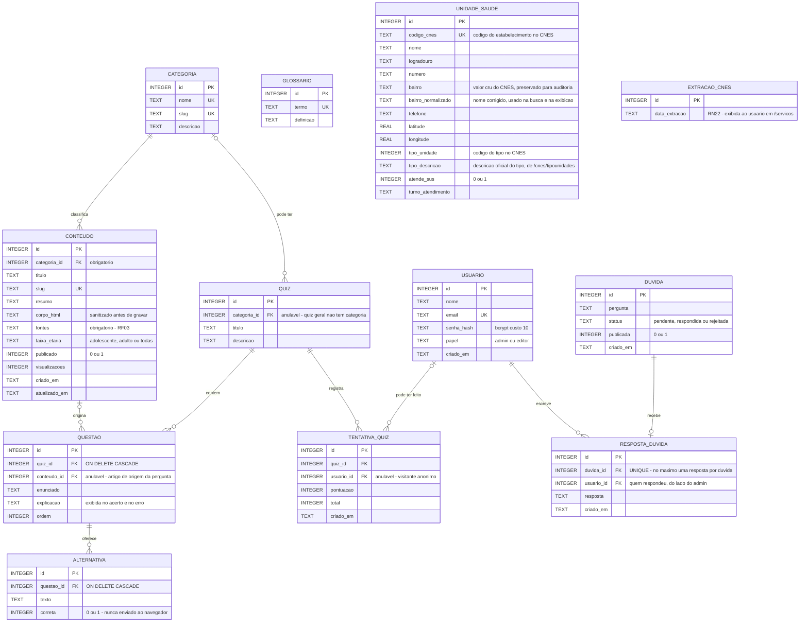

# DER — Diagrama Entidade-Relacionamento

Modelo lógico do banco, espelhando `database/schema.sql`. Desenhado em Mermaid
(`erDiagram`) para renderizar direto no GitHub, sem ferramenta externa — mesma
decisão dos diagramas BPMN em `docs/bpmn/`.

Notação de cardinalidade do Mermaid:

| Símbolo | Significado |
|---|---|
| `\|\|` | exatamente um |
| `\|o` | zero ou um |
| `o{` | zero ou muitos |

O banco tem **doze tabelas**. Todas as chaves primárias são `INTEGER PRIMARY KEY
AUTOINCREMENT` (o `rowid` do SQLite).

## Relacionamentos e por que cada um é assim

| Relacionamento | Cardinalidade | Justificativa |
|---|---|---|
| `categoria` → `conteudo` | 1 : N | `conteudo.categoria_id` é `NOT NULL`: todo artigo pertence a exatamente uma categoria, o que sustenta a trilha por categoria (RF01 e RF14). |
| `categoria` → `quiz` | 0..1 : N | `quiz.categoria_id` é **anulável** por causa do quiz geral, que atravessa temas e não pertence a nenhuma categoria. |
| `conteudo` → `questao` | 0..1 : N | `questao.conteudo_id` é **anulável**: a pergunta pode citar o artigo de origem (e aí o resultado mostra "Reveja: …" — recurso da Sprint 7, sem RF próprio na especificação) ou ser uma pergunta geral da categoria. |
| `quiz` → `questao` | 1 : N | `ON DELETE CASCADE` — apagar um quiz apaga suas questões, que não fazem sentido sozinhas. |
| `questao` → `alternativa` | 1 : N | `ON DELETE CASCADE`, pelo mesmo motivo. A coluna `correta` vive só aqui e nunca é enviada ao navegador antes da resposta (RF08). |
| `quiz` → `tentativa_quiz` | 1 : N | Cada tentativa registra pontuação e total de um quiz. |
| `usuario` → `tentativa_quiz` | 0..1 : N | `usuario_id` é **anulável**: o site é usado sem login, então a maioria das tentativas é anônima. |
| `duvida` → `resposta_duvida` | 1 : 0..1 | `duvida_id` é `UNIQUE`: uma dúvida recebe no máximo uma resposta oficial. `ON DELETE CASCADE`. |
| `usuario` → `resposta_duvida` | 1 : N | Identifica **quem respondeu** (admin ou editor) — nunca quem perguntou. |

## Três ausências propositais de relacionamento

Estas não são esquecimento de modelagem; são requisitos:

- **`duvida` não tem nenhuma FK para `usuario`, nem coluna de IP, e-mail ou nome.**
  O canal de dúvidas é anônimo por projeto (RNF21 e RN11). O vínculo com `usuario` existe
  apenas do lado da resposta, para saber qual administrador respondeu.
- **`glossario` é uma tabela isolada, sem relacionamento.** É um verbete independente,
  sem ligação com categoria ou conteúdo — simplicidade deliberada.
- **`extracao_cnes` guarda uma linha só, sem relacionamento.** Registra a data da
  extração da base (RN22). Não se liga a `unidade_saude` porque a base é substituída
  inteira a cada importação: a data vale para a carga toda, não para cada unidade.
- **`unidade_saude` também é isolada.** É um espelho local de uma base pública externa
  (o CNES, do Ministério da Saúde), recarregado inteiro a cada importação
  (`npm run importar:cnes`). Ligá-la a `categoria` ou `conteudo` criaria uma dependência
  entre dado nosso e dado de terceiro que a recarga quebraria. `codigo_cnes` é `UNIQUE`
  para a importação ser idempotente.
- **`bairro` e `bairro_normalizado` convivem de propósito.** O CNES trunca o nome do
  bairro em 20 caracteres e traz erro de digitação, abreviação e subdivisão informal —
  95 grafias para cerca de 63 bairros. A busca e a tela usam `bairro_normalizado`,
  corrigido na importação pela tabela de `src/services/bairro.service.js`; o valor cru
  fica em `bairro` para a origem do dado continuar verificável. Não é redundância: uma
  coluna é o que o Ministério publicou, a outra é o que a plataforma afirma.

Vale registrar também que **nenhuma tabela armazena dado de saúde de indivíduo**
(RNF21). `tentativa_quiz` guarda apenas acertos e total, sem as respostas
individuais e, na prática, sem identificação de quem respondeu.

## Manutenção

Este diagrama reflete `database/schema.sql`. Ao alterar o schema, altere aqui também —
e lembre que `schema.sql` usa `CREATE TABLE IF NOT EXISTS`, portanto não modifica tabela
já existente: mudanças de coluna precisam de entrada correspondente em
`database/migrar.js` (`npm run migrar`), como foi feito para `questao.conteudo_id`.
